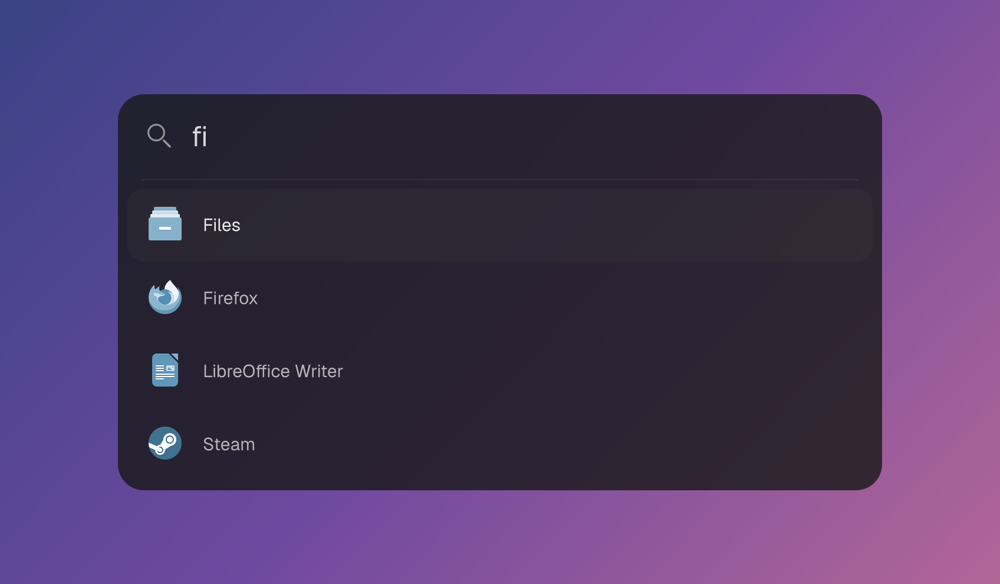

<p align="center">
  
</p>

# aial

A small Spotlight-style app launcher for [Quickshell](https://quickshell.org) 0.3+
on Wayland: one search box and an animated result list. Apps are matched and
ordered exactly like in [wave-launcher](https://github.com/Kalkaro/wave-launcher),
whose port of rofi's drun search it uses unchanged.

## Run

```sh
nix run github:Kalkaro/aial
```

Without Nix, clone the repository and run `./launch.sh`. It needs `quickshell`
(`qs`), `flock` and `setsid` (util-linux), and GNU coreutils. Nix supplies all of
them and pins Nixpkgs in `flake.lock`, for x86-64 and ARM64 Linux.

`nix-shell` or `nix develop` enter a shell with the same tools and an
`aial` command for the packaged app.

### Home Manager

The flake has a Home Manager module. Add the flake as an input, import the
module and enable it:

```nix
# flake.nix
inputs.aial = {
  url = "github:Kalkaro/aial";
  inputs.nixpkgs.follows = "nixpkgs";
};
```

```nix
# your Home Manager configuration
{ inputs, ... }:
{
  imports = [ inputs.aial.homeModules.default ];

  programs.aial = {
    enable = true;
    colors.base00 = "#1e1e2e";
    opacity = 0.85;
    rows = 6;
    hyprlandKeybind = "SUPER, SPACE";
  };
}
```

`enable` installs `aial`, writes the settings to `~/.config/aial/config.json`, and
starts the panel hidden with your graphical session as a systemd user service, so
it is already resident the first time you open it. A rebuild that changes the
settings updates an open panel without a restart. Every option is listed under
[Settings](#settings).

The flake also provides `overlays.default`, which adds `pkgs.aial`, for use as
`programs.aial.package` or on its own. The module is `homeManagerModules.default`
too.

## Use

Run the launcher again to toggle the panel. Escape or an outside click (on
Hyprland) hides it. Results update as you type; clearing the query collapses the
card. Icons come from your current icon theme.

| Key | Action |
| --- | --- |
| ↑ / ↓ | Select a result |
| Enter | Launch the application |
| Escape | Hide |

```sh
./launch.sh --hidden   # start without opening
./launch.sh --stop     # quit
```

Both work the same through `nix run . --`. The checkout and Nix launchers share
one resident instance per display and namespace, and launching changed source
restarts it with the updated code.

For a Hyprland shortcut from a checkout, use your absolute project path:

```ini
bind = SUPER, SPACE, exec, /path/to/aial/launch.sh
exec-once = /path/to/aial/launch.sh --hidden
```

With Nix, `hyprlandKeybind = "SUPER, SPACE"` adds the same bind. It writes
hyprlang, so it does not work with `wayland.windowManager.hyprland.configType =
"lua"`; there, bind the `aial` command in your own config:

```lua
hl.bind(mod .. " + SPACE", hl.dsp.exec_cmd("aial"))
```

Applications start through `systemd-run --user` when it is available, with the
session's environment rather than the launcher's, in their own unit; their
output goes to the user journal. Terminal applications open in `$TERMINAL`,
`xdg-terminal-exec`, or the first installed of kitty, foot, Alacritty, WezTerm,
Ghostty, Konsole, GNOME Terminal, Console, Xfce Terminal, or xterm.

### Namespaces

`-n` or `--namespace` sets the Wayland layer namespace, default `applesearch`:

```sh
./launch.sh -n 123
./launch.sh --namespace 123 --hidden
./launch.sh -n 123 --stop
```

Each name has an independent panel; toggle, `--hidden`, and `--stop` affect only
the selected namespace. The launch history and settings are shared. Use the
namespace in compositor layer rules to target that panel. With Home Manager,
`programs.aial.namespace` sets the one the keybinds and the service use.

## Search

Apps come from the desktop entries Quickshell finds in your XDG data
directories, except hidden and `NoDisplay` ones. They are searched by
wave-launcher's `rofi-search.js`, copied byte for byte, with wave-launcher's
default settings: rofi's drun defaults, plus its name-first order and
keyboard-layout matching.

- Every word typed must appear, ignoring case, in an app's name, generic name,
  Exec line, categories, or keywords. A word starting with `-` excludes the
  apps it matches. Words typed in the Russian keyboard layout also match the
  English letters on the same keys, so `ашкуащч` finds Firefox.
- Apps matching every word by name come first, then those that need the
  generic name, keywords, categories, and lastly the Exec line. Within each
  group, recently launched apps come first, most recent first, then the rest
  alphabetically.

Each launch is recorded in rofi's drun history format in
`$XDG_CACHE_HOME/applesearch.druncache` (default `~/.cache/applesearch.druncache`),
which keeps the last 25 apps. Seven results fit at a time, unless `rows` says
otherwise; the arrow keys and the mouse wheel scroll through the rest. The
[settings](#settings) change how words match and whether history is used.

## Clipboard history

Lines piped into the launcher turn the panel into a dmenu-style picker, like
`rofi -dmenu -display-columns 2`. With [cliphist](https://github.com/sentriz/cliphist),
that makes a clipboard history:

```ini
bind = SUPER, V, exec, cliphist list | /path/to/aial/launch.sh | cliphist decode | wl-copy
```

The picker has no search field. It lists the lines in their order, so
cliphist's stay newest first, with the first one selected. The arrow keys and
the mouse wheel move through them. Enter or a click prints the chosen line;
Escape, or hiding the panel any other way, prints nothing and exits with
status 1. A line shows the text after its first tab, so cliphist's
`id<TAB>preview` lines show just the preview. Seven rows fit at a time by
default, and the first 100 lines are listed.

Copied images show as thumbnails: before the menu opens, `launch.sh` runs
`cliphist decode` on each image among those lines. An image in a format Qt
can't read, such as TIFF, keeps a plain image icon.

`launch.sh` hands the lines and images to the panel in a folder only you can
read, under `$XDG_RUNTIME_DIR/applesearch`, and deletes it when the menu closes.

## Colors

The launcher reads `$XDG_CONFIG_HOME/stylix/palette.json` (default
`~/.config/stylix/palette.json`) at runtime. `base00` is the panel background, at
80% opacity; text uses `base05`, secondary text uses `base04`, row selection
uses `base02`, and accents use `base0D`. Light and dark palettes are detected
from `base00`. Colors set in the [settings](#settings) win over the palette
file, one by one, so you can override just `base00`; the file's `palette` key
(`programs.aial.palette`) picks another palette file.

Palette changes update the UI without a restart. The palette is also refreshed
when opening the panel and every two seconds while it is visible, to handle
Nix-managed symlink replacements. Invalid colors keep their previous values; a
default Base16 palette is used when Stylix is unavailable. To use a different
palette file:

```sh
APPLESEARCH_PALETTE="$HOME/.config/my-colors.json" ./launch.sh
```

## Settings

The panel reads `$XDG_CONFIG_HOME/aial/config.json` (default
`~/.config/aial/config.json`), or the file in `$APPLESEARCH_CONFIG`. Every key is
optional, and the file is followed while the panel is open. Values past a range
are clamped to it, and a key of the wrong type, or an unknown choice, is ignored.
A file that does not parse leaves the last settings in place. Home Manager writes
this file from `programs.aial`, with the same names:

```json
{
  "colors": { "base00": "#1e1e2e", "base0D": "#89b4fa" },
  "opacity": 0.85,
  "rows": 6,
  "search": { "matching": "fuzzy" },
  "history": { "size": 50 }
}
```

| Key | Default | |
| --- | --- | --- |
| `colors.base00` … `colors.base0F` | from the palette | Base16 colors as `#rrggbb`. |
| `palette` | Stylix's `palette.json` | A palette file to read, which `colors` win over. |
| `opacity` | `0.8` | Opacity of the `base00` background, 0 to 1. |
| `cornerRadius` | `22` | Corner radius in pixels, 0 to 36. |
| `borderOpacity` | `0.2` | Opacity of the 1 px `base05` border, as Hyprland draws on windows. 0 hides it. |
| `width` | `680` | Panel width in pixels, 320 to 1600, and never wider than the screen less 48. |
| `topOffset` | `0.22` | Distance from the top as a share of the screen's height, 0 to 0.8. |
| `rows` | `7` | Results shown before the list scrolls, 1 to 12. |
| `placeholder` | `"Search apps"` | Text of the empty search field. |
| `font.family` | bundled Geist | An installed font family. |
| `font.size`, `font.searchSize` | `15`, `24` | Pixel size of result names, and of the search field. |
| `search.matching` | `"normal"` | `normal`, `regex`, `glob`, `fuzzy` or `prefix`, as rofi's `-matching`. |
| `search.normalize` | `false` | Ignore diacritics when matching. |
| `search.sort` | `false` | Sort matches by how well they match. |
| `search.sortingMethod` | `"normal"` | `normal` or `fzf`, when sorting. |
| `search.matchFields` | `["name", "generic", "exec", "categories", "keywords"]` | Fields words are looked for in; `comment` can be added. A comma-separated string works too. |
| `search.preferNameMatch` | `true` | Apps matching by name come first. |
| `history.enable` | `true` | Recent apps come first, and launches are recorded. |
| `history.size` | `25` | Apps the history keeps. |

The search defaults are wave-launcher's. The Home Manager options also include:

| Option | Default | |
| --- | --- | --- |
| `enable`, `package` | | Install aial. `package` is this flake's by default. |
| `namespace` | `"applesearch"` | The panel the keybinds and the service use, as `-n`. |
| `colors.<name>` | `null` | A color left `null` comes from the palette file. |
| `stylix.enable` | `false` | Fill the colors not set by hand from Stylix's, which needs its Home Manager module. |
| `font.packages` | `[ ]` | Packages that provide `font.family`. |
| `service.enable` | `true` | Start the panel hidden with the graphical session. |
| `hyprlandKeybind` | `null` | A hyprlang `bind`, such as `"SUPER, SPACE"`, that toggles the panel. |
| `hyprlandClipboardKeybind` | `null` | A `bind` that picks from your `cliphist` history and copies it. |

## Development

```sh
nix flake check   # the tests, the module, formatting and the package
nix fmt           # nixfmt
node --test tests/test_rofi_search.js
python3 -m unittest discover -s tests -v
qs log -p . --no-color -t 50
qs ipc -p . call spotlight state
qs ipc -p . call spotlight search firefox
```

QML reloads automatically when edited in the default namespace. For custom
namespaces, rerun the launcher to apply edits.

`rofi-search.js` and `tests/test_rofi_search.js` are copies of wave-launcher's;
update them there and copy them over rather than editing them here.

## License

[MIT](LICENSE). The search logic is ported from
[Rofi](https://github.com/davatorium/rofi) (MIT, see
[licenses/rofi-MIT.txt](licenses/rofi-MIT.txt)). The bundled Geist Sans is under
the SIL Open Font License; see [fonts/README.md](fonts/README.md).
